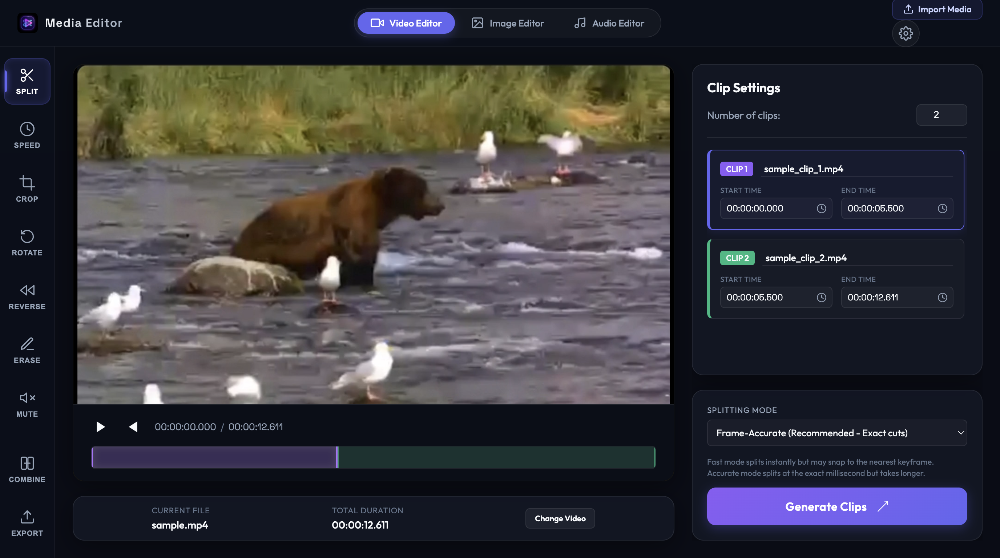
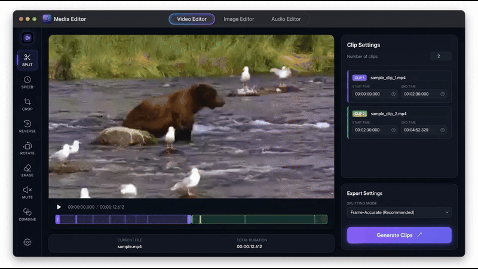
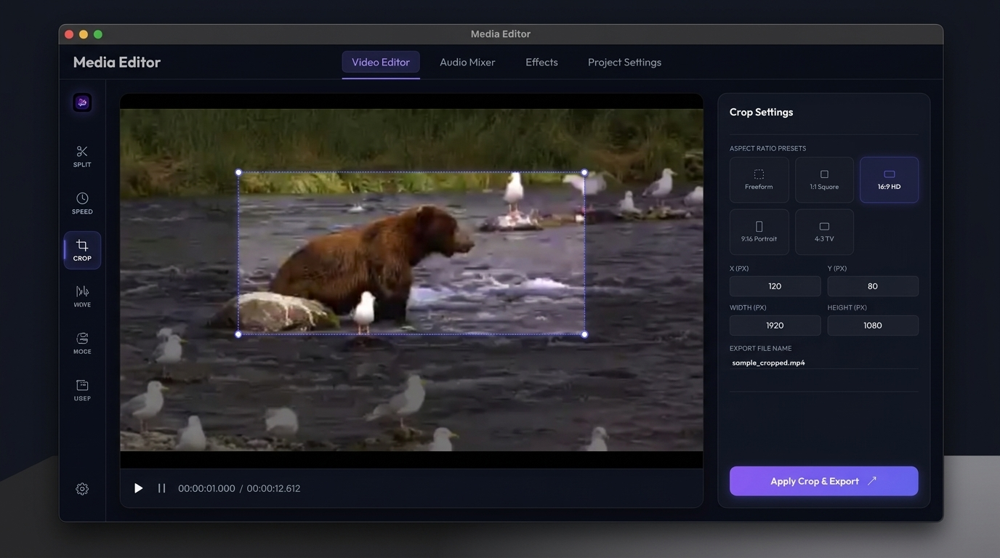
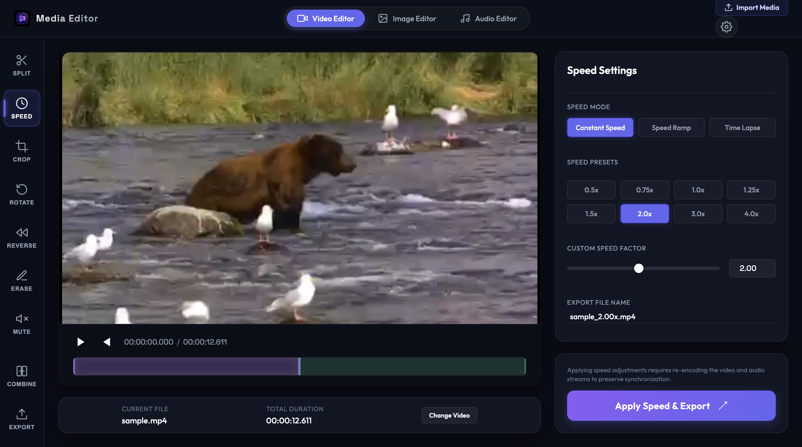
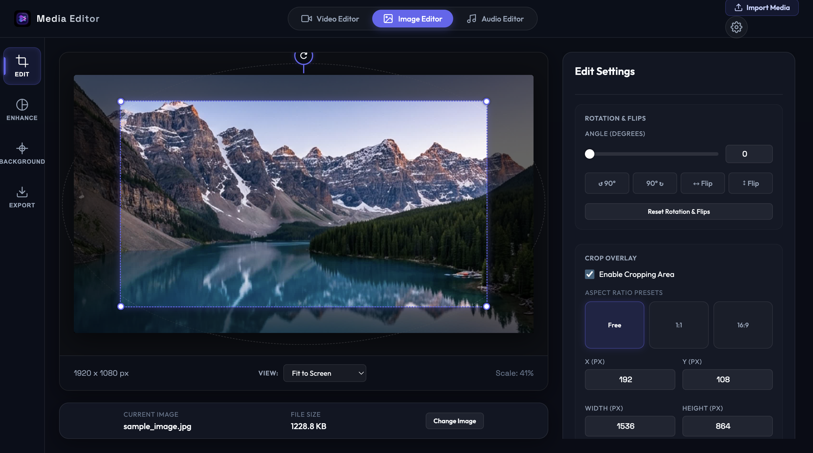

# macOS Media Editor

A high-fidelity macOS desktop application designed to edit, split, transform, and enhance video, image, and audio files. Built on Electron with a dark-mode studio interface, this application provides persistent tools, embedded monitor workspaces, interactive timeline scrubbers, canvas-based image manipulators, real-time range overlays, and high-performance bundled FFmpeg operations.



---

## 📺 Media Demonstration



> [!TIP]
> A high-resolution demonstration video is bundled directly in the repository at [`./media_editor_demo.mp4`](./media_editor_demo.mp4).

---

## App Sections & Key Features

### 🎬 Video Editor Section
The Video Editor provides a suite of 8 specialized, interactive tools. All tool panels and configuration options remain immediately accessible and visible even before a file is imported:

*   **Integrated Monitor & Dropzone**: Drag and drop any video file (`.mp4`, `.mov`, `.mkv`, `.avi`, `.webm`) directly into the player monitor, or use the native macOS file picker.
*   **Video Splitter Tool**:
    *   *Frame-Accurate Splitting (Default)*: High-speed re-encoding with H.264 (`superfast` preset) and AAC audio cuts video at the exact millisecond, preventing keyframe seek drift.
    *   *Fast / Keyframe Copy Mode*: Lossless stream copy (`-c copy`) for near-instant splitting where keyframe alignment is acceptable.
    *   *Real-time Range Overlays*: Color-coded segments render along the timeline scrubber for immediate visual verification of clip boundaries.
    *   *Live Input Synchronization*: Time changes sync on keystroke, blur, and Enter, backed by mathematical validation (`validateAndNormalizeClips`).
    *   *Current Time Capture*: One-click "Use Current Time" buttons sync playhead position to clip start/end timestamps.
*   **Video Speed Changer Tool**:
    *   *Constant Speed*: Uniform speed multipliers from `0.25x` to `10.0x` with quick-select presets (`0.5x`, `0.75x`, `1.0x`, `1.25x`, `1.5x`, `2.0x`, `3.0x`, `4.0x`).
    *   *Speed Ramp*: Progressive symmetrical bell-curve acceleration and deceleration using customized multi-slice FFmpeg filter chains.
    *   *Sync Pitch*: Audio pitch and speed stay synchronized via chained `atempo` filters.
    *   *Audio Fallback*: Automatically applies video-only speedups if no audio stream exists.
*   **Video Frame Cropper Tool**:
    *   Interactively position and resize a dashed crop boundary box with corner handles directly on the video monitor.
    *   Aspect ratio lock presets: `Freeform`, `1:1 Square`, `16:9 HD`, `9:16 Portrait`, `4:3 TV`.
    *   Manual pixel coordinate inputs (X, Y, Width, Height) synchronized with the visual overlay.
*   **Video Reverser Tool**:
    *   *Reverse Playback Preview*: Preview video in reverse in real time before exporting.
    *   *Audio Control*: Reverse audio in sync with video or mute the audio track completely.
    *   *Stream Safety*: Bypasses audio reversing seamlessly if the input video contains no audio track.
*   **Video Rotate Tool**:
    *   Rotate videos by 90° Clockwise, 90° Counter-Clockwise, or 180° with automatic audio preservation.
*   **Video Logo & Text Eraser Tool**:
    *   *Interactive Region Selection*: Draw a resizable boundary overlay over any logo, watermark, or text box on the video frame.
    *   *Three Erasure Modes*:
        *   *Smooth Blur (Gaussian)*: Crops the target region, applies a smooth `boxblur`, and blends it back over the source frame.
        *   *Solid Color Block (Blackout)*: Covers the target region with a solid black rectangle using the `drawbox` filter.
        *   *Pixel Interpolation (Delogo)*: Interpolates the selected region using surrounding pixels via FFmpeg's `delogo` filter.
    *   Manual dimension inputs for fine pixel tuning.
*   **Video Mute (Audio Stripper) Tool**:
    *   Strips audio tracks in milliseconds via direct video stream copy (`-c:v copy`), preserving 100% of video quality without re-encoding.
*   **Video Combiner Tool**:
    *   Merge multiple video clips sequentially into a continuous video.
    *   Reorder clips via an interactive list with drag-and-drop or order arrows.
    *   Automatic PTS generation and timescale normalization prevent timestamp desynchronization.




---

### 🖼️ Image Editor Section
A complete client-side canvas-powered image processing studio:

*   **Drag & Drop Import**: Import images (`.png`, `.jpg`, `.jpeg`, `.webp`, `.gif`, `.bmp`) by dropping into the monitor or browsing files.
*   **AI Background Removal**:
    *   One-click, fully offline background removal powered by an embedded WebAssembly AI model.
    *   No internet connection or external cloud API keys required; runs on device via Web Workers.
    *   Exports clean cutouts with alpha transparency in `.png` format.
*   **Precision Rotation & Mirroring**:
    *   Rotate images interactively using a visual circular rotation knob or fine-tune degrees slider (`-360°` to `360°`).
    *   Quick 90° rotation buttons (`↺ 90°` / `90° ↻`) and horizontal/vertical mirroring flips.
    *   Dynamically recalculates transformed canvas bounds to prevent pixel clipping.
*   **Visual Crop Box**:
    *   Dashed visual crop frame with four corner handles and aspect ratio constraints (`Free`, `1:1`, `16:9`).
    *   Synchronized manual inputs for X, Y, Width, and Height.
*   **Photo Quality Enhancer**:
    *   *Crisp Sharpening*: Spatial 2D convolution kernel matrices enhance edge contrast.
    *   *Color Boost*: Real-time color saturation enhancement.
    *   *Auto-Contrast & Noise Reduction*: Sliders with live preview rendering.
*   **Print & Download Sizing Presets (300 DPI)**:
    *   Standard print sizes: 4"x6" Photo (1200x1800 px), 5"x7" Portrait (1500x2100 px), 8"x10" Gallery (2400x3000 px), 11"x14" Premium Art (3300x4200 px), **18"x24" Poster Size** (5400x7200 px), or A4 Sheet (2480x3508 px) in Portrait or Landscape orientation.
    *   Custom scale multipliers: 2x, 3x, and 4x.
*   **Viewport Scaling Modes**:
    *   *Fit to Screen*: Responsively scales the entire transformed image within the preview container.
    *   *Fit Width (Scroll Y)*: Expands image to container width with smooth vertical scrolling.
    *   *Original Size*: 1:1 pixel rendering with horizontal and vertical scrollbars.
*   **Multi-Format Export**: Save high-resolution outputs directly to **PNG**, **JPEG/JPG**, and **WebP**.



---

### 🎵 Audio Editor Section
*   **High-Quality Extraction**: Extract audio tracks from any supported video file (`.mp4`, `.mov`, `.mkv`, etc.).
*   **Output Formats**: Export directly to **MP3** (`libmp3lame`), **WAV** (`pcm_s16le`), **AAC**, and **OGG** (`libvorbis`).
*   **Interactive Visuals**: Embedded bouncing waveform visualizer and real-time conversion progress tracking.

---

## Tech Stack

*   **Runtime Framework**: Electron (v30)
*   **Frontend**: Vanilla HTML5, CSS3 (Custom Studio Variables, Flexbox, Keyframe Animations), Vanilla JavaScript (Context-Isolated Preload Bridge)
*   **Video Engine**: FFmpeg (static macOS binaries bundled via `ffmpeg-static`)
*   **AI Background Removal**: `@imgly/background-removal` (offline WebAssembly)
*   **Image Processing Engine**: HTML5 Canvas 2D API with 2D Convolution Filters
*   **Unit Testing**: Vitest (v1.6)

---

## Prerequisites

Make sure you have Node.js and npm installed on your Mac:
*   **Node.js**: `v18` or higher (tested on `v24.14.0`)
*   **npm**: `v9` or higher (tested on `11.9.0`)

No external installation of FFmpeg, Homebrew, or ImageMagick is required; the application bundles all necessary binaries natively.

---

## Installation & Setup

> [!TIP]
> **For Autonomous AI Agents**: A machine-actionable guide with verification steps and preflight checks is provided in [`AGENT_SETUP.md`](./AGENT_SETUP.md).

1.  **Clone the repository**:
    ```bash
    git clone <repository-url>
    cd media-editor
    ```

2.  **Install dependencies locally**:
    ```bash
    npm install
    ```

3.  **Run the application in development**:
    ```bash
    npm start
    # or
    npm run dev
    ```

4.  **Run unit tests**:
    ```bash
    npm run test
    ```

---

## Packaging as a macOS App (Double-Clickable)

To compile the application into a standalone, double-clickable macOS desktop `.app` bundle, run:
```bash
npm run package
```
This packages the application and generates the ready-to-run app bundle in:
`./dist/mac-arm64/Media Editor.app` (or `./dist/mac/` depending on processor architecture).

### macOS Security Gatekeeper Note (For Unsigned Local Builds)
Because the app is built locally without an Apple Developer certificate, macOS Gatekeeper will block the application on the initial double-click. To open it:
1.  Open Finder and navigate to `./dist/mac-arm64/`.
2.  **Right-Click (Control-Click)** the **Media Editor.app** bundle.
3.  Click **Open** from the context menu.
4.  Select **Open** in the macOS confirmation dialog.
5.  The application will launch and will open on all subsequent double-clicks.

---

## Usage Guide

### General Navigation
Use the header tabs (**Video Editor**, **Image Editor**, **Audio Editor**) to switch between editing modes. Switching tabs automatically pauses active video playback. Use the bottom gear icon in the left rail to configure global export preferences (default export directory and splitting mode).

### 🎬 Video Editing

#### Video Splitter Mode
1.  In the **Split** tool panel, select the desired number of clips (default: 2).
2.  Adjust the **Start Time** and **End Time** for each clip card:
    *   Enter timestamps directly in `HH:MM:SS.mmm` or `MM:SS` format.
    *   Or, scrub the video to a point and click the clock button next to the input to lock the current timestamp.
3.  Select the **Splitting Mode**:
    *   *Frame-Accurate (Recommended)*: Cuts at the exact millisecond via H.264/AAC re-encoding.
    *   *Fast*: Lossless stream copy snapping to the nearest keyframe.
4.  Click **Generate Clips ↗**, select an export destination, and click **Open in Finder** upon completion.

#### Video Speed Changer Mode
1.  Select **Constant Speed** or **Speed Ramp**.
2.  Choose a preset multiplier or drag the speed slider (`0.25x` to `10.0x`).
3.  Verify the prefilled output filename and click **Apply Speed & Export ↗**.

#### Video Frame Cropper Mode
1.  Select the **Crop** tool to reveal the visual crop overlay.
2.  Drag the overlay handles or choose an aspect ratio preset (`Freeform`, `1:1`, `16:9`, `9:16`, `4:3`).
3.  Click **Apply Crop & Export ↗**.

#### Video Reverser Mode
1.  Select the **Reverse** tool in the navigation rail.
2.  Toggle **Reverse Audio** or leave unchecked to mute audio.
3.  Use the **Play Reverse** button in the player control bar to preview the reverse playback.
4.  Click **Reverse & Export ↗**.

#### Video Rotate Mode
1.  Select the **Rotate** tool.
2.  Choose the rotation angle (90° Clockwise, 90° Counter-Clockwise, or 180°).
3.  Click **Rotate & Export ↗**.

#### Video Logo & Text Eraser Mode
1.  Select the **Erase** tool.
2.  Choose your **Erase Style**: `Smooth Blur (Gaussian)`, `Solid Color Block (Blackout)`, or `Pixel Interpolation (Delogo)`.
3.  Position and scale the red dashed bounding box over the watermark or logo.
4.  Click **Apply Erase & Export ↗**.

#### Video Audio Removal (Mute) Mode
1.  Select the **Mute** tool.
2.  Verify the output filename and click **Remove Audio & Export ↗**.

#### Video Combiner Mode
1.  Select the **Combine** tool.
2.  Click **+ Add Clips** to import multiple video files.
3.  Reorder clips using the order arrows (↑ / ↓) or remove clips with ✕.
4.  Choose combining mode (*Fast* or *Accurate*) and click **Combine & Export ↗**.

---

### 🖼️ Image Editing

1.  Click the **Image Editor** header tab.
2.  Drag and drop an image or click **Browse Image**.
3.  **Rotate / Flip**: Use the circular handle, slider, or preset buttons (`↺ 90°` / `90° ↻`, Horizontal/Vertical flip).
4.  **Crop**: Enable the crop overlay, drag handles, or select aspect ratio presets (`Free`, `1:1`, `16:9`).
5.  **Enhance**: Switch to the **Enhance** tab to adjust Crisp Sharpening, Color Boost, Auto-Contrast, and Denoise.
6.  **AI Background Removal**: Switch to the **Background** tab and click **Remove Background ✨** to remove the background offline.
7.  **Export**: Select the output format (**PNG**, **JPEG**, or **WebP**), verify the filename, and click **Export Image ↗**.

---

## Testing

This project uses Vitest to test time calculations, boundary normalization, filter complexes, and math utilities. The test suite is located in [`helpers.test.js`](./helpers.test.js) and contains **61 automated unit tests** across 11 test suites:

*   `secondsToTimestamp`: Integer seconds, decimal milliseconds, invalid input handling.
*   `timestampToSeconds`: Parsing `HH:MM:SS.mmm`, `HH:MM:SS`, `MM:SS`, raw seconds, malformed string protection.
*   `isValidTimestampFormat`: Format regex validation.
*   `validateAndNormalizeClips`: Clip boundary verification, time ordering, string-to-number normalization, error catching.
*   `getAudioSpeedFilter`: Single-filter audio scaling and chained `atempo` multipliers outside [0.5, 2.0].
*   `mapCropToNative`: Coordinate scaling and boundary clamping between display and native frame dimensions.
*   `getSpeedRampFilterComplex`: Progressive 5-slice speed curve filter generation.
*   `getRotatedCanvasDimensions`: Canvas bounding-box dimension calculations for arbitrary rotation angles.
*   `getReverseFilterComplex`: Audio and video reversing filter chains.
*   `getEraseFilterComplex`: Blur, drawbox, and delogo boundary clamping.
*   `Image enhancement and print sizing`: Print dimension calculations up to 18"x24", 2D convolution kernels, pixel transforms, and viewport class resolution.

To run the complete test suite:
```bash
npm run test
```

---

## Project Structure

*   [`README.md`](./README.md) - Primary project overview, features, and user guide.
*   [`AGENT_SETUP.md`](./AGENT_SETUP.md) - Machine-actionable setup and installation guide for autonomous AI agents.
*   [`main.js`](./main.js) - Electron main process: window lifecycle, IPC handlers (`split-video`, `speed-video`, `crop-video`, `reverse-video`, `rotate-video`, `erase-video`, `mute-video`, `combine-videos`, `extract-audio`), custom `media://` streaming protocol, and FFmpeg execution.
*   [`preload.js`](./preload.js) - Secure context bridge (`electronAPI`) exposing IPC methods to the renderer.
*   [`renderer.js`](./renderer.js) - Studio application controller: tool navigation, timeline scrubbers, clip synchronization, canvas rendering, and export flows.
*   [`helpers.js`](./helpers.js) - Pure mathematical, time-formatting, FFmpeg filter generation, and clip validation utilities.
*   [`helpers.test.js`](./helpers.test.js) - Comprehensive Vitest unit test suite (61 tests).
*   [`index.html`](./index.html) - Application layout with embedded player dropzones, persistent 8-tool rail, image canvas, and audio mixer.
*   [`style.css`](./style.css) - Dark-mode studio stylesheet, custom scrubbers, glassmorphism card surfaces, and responsive monitor viewports.
*   [`split_feature_ui.png`](./split_feature_ui.png) - Visual screenshot of the Video Splitter interface.
*   [`crop_feature_ui.png`](./crop_feature_ui.png) - Visual screenshot of the Video Frame Cropper interface.
*   [`speed_feature_ui.png`](./speed_feature_ui.png) - Visual screenshot of the Video Speed Changer interface.
*   [`image_editor_ui.png`](./image_editor_ui.png) - Visual screenshot of the Image Editor interface.
*   [`media_editor_demo.mp4`](./media_editor_demo.mp4) - High-resolution workflow video demonstration.
*   [`media_editor_demo.gif`](./media_editor_demo.gif) - Animated workflow preview.
